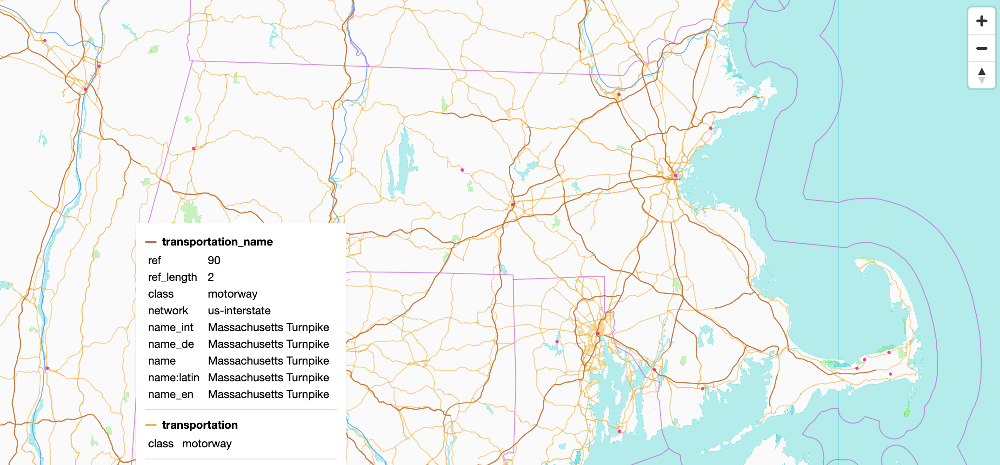

# Planetiler

Planetiler is a tool that generates [Vector Tiles](https://github.com/mapbox/vector-tile-spec/tree/master/2.1)
from geographic data sources like [OpenStreetMap](https://www.openstreetmap.org/). Planetiler aims to be fast and
memory-efficient so that you can build a map of the world in a few hours on a single machine without any external tools
or database.

Vector tiles contain raw point, line, and polygon geometries that clients like [MapLibre](https://github.com/maplibre)
can use to render custom maps in the browser, native apps, or on a server. Planetiler packages tiles into
an [MBTiles](https://github.com/mapbox/mbtiles-spec/blob/master/1.3/spec.md) (sqlite)
or [PMTiles](https://github.com/protomaps/PMTiles) file that can be served using tools
like [TileServer GL](https://github.com/maptiler/tileserver-gl) or [Martin](https://github.com/maplibre/martin) or
even [queried directly from the browser](https://github.com/protomaps/PMTiles/tree/main/js).
See [awesome-vector-tiles](https://github.com/mapbox/awesome-vector-tiles) for more projects that work with data in this
format.

Several full-featured basemaps are built using planetiler:

- [OpenMapTiles](https://github.com/openmaptiles/planetiler-openmaptiles)
- [Protomaps Basemaps](https://github.com/protomaps/basemaps/tree/main/tiles)
- [Shortbread](./planetiler-custommap/src/main/resources/samples/shortbread.yml)

You can also create your own custom base maps or overlays
using [YAML](#option-1-custom-maps-using-yaml-no-java-required)
or [Java](#option-2-custom-maps-using-java-profiles).

See the [live demo](https://onthegomap.github.io/planetiler-demo/) of vector tiles created by Planetiler
and [hosted by OpenStreetMap US](https://github.com/osmus/tileservice).

[](https://onthegomap.github.io/planetiler-demo/)
[© OpenMapTiles](https://www.openmaptiles.org/) [© OpenStreetMap contributors](https://www.openstreetmap.org/copyright)

## Quick start

Install (macOS or Linux with Homebrew, [other options below](#install)):

```bash
brew install planetiler
```

Build a map of Monaco:

```bash
planetiler --download --area=monaco --output=monaco.pmtiles
```

View it by dragging `monaco.pmtiles` onto [pmtiles.io](https://pmtiles.io/).

:warning: The first run downloads about 1GB of [data sources](NOTICE.md#data) required by the OpenMapTiles profile,
including ~750MB for ocean polygons and ~240MB for [Natural Earth Data](https://www.naturalearthdata.com/). To try it
out with much smaller downloads, add these arguments (they only work for Monaco):

```bash
planetiler --download --area=monaco --output=monaco.pmtiles \
  --water-polygons-url=https://github.com/onthegomap/planetiler/raw/main/planetiler-core/src/test/resources/water-polygons-split-3857.zip \
  --natural-earth-url=https://github.com/onthegomap/planetiler/raw/main/planetiler-core/src/test/resources/natural_earth_vector.sqlite.zip
```

## Install

|                    Method                     | Needs Java? |                   Good for                    |                 Command to run                 |
|-----------------------------------------------|-------------|-----------------------------------------------|------------------------------------------------|
| [Homebrew](#homebrew)                         | no          | macOS and Linux desktops                      | `planetiler`                                   |
| [Single-file launcher](#single-file-launcher) | no          | supported platforms or servers (experimental) | `./planetiler` (`.\planetiler.exe` on Windows) |
| [Jar](#jar)                                   | Java 25+    | existing Java setups, custom profiles         | `java -jar planetiler.jar`                     |
| [Docker](#docker)                             | no          | containers                                    | `docker run ... ghcr.io/onthegomap/planetiler` |

### Homebrew

```bash
brew install planetiler
planetiler --help
```

### Single-file launcher

An experimental single executable that bundles `planetiler.jar` and a minimal Java runtime, so you don't need to
install Java. Download the one for your platform from the
[latest snapshot release](https://github.com/onthegomap/planetiler/releases/latest-main), extract it, and run it.

**macOS (Apple Silicon)**

```bash
curl -fL https://github.com/onthegomap/planetiler/releases/download/latest-main/planetiler_snapshot_darwin_arm64.tar.gz | tar -xz
./planetiler --help
```

**macOS (Intel)**

```bash
curl -fL https://github.com/onthegomap/planetiler/releases/download/latest-main/planetiler_snapshot_darwin_amd64.tar.gz | tar -xz
./planetiler --help
```

**Linux (x86-64):**

```bash
curl -fL https://github.com/onthegomap/planetiler/releases/download/latest-main/planetiler_snapshot_linux_arm64.tar.gz | tar -xz
./planetiler --help
```

**Linux (ARM64):**

```bash
curl -fL https://github.com/onthegomap/planetiler/releases/download/latest-main/planetiler_snapshot_linux_arm64.tar.gz | tar -xz
./planetiler --help
```

**Windows (x86-64, PowerShell):**

```powershell
curl.exe -fLo planetiler.zip https://github.com/onthegomap/planetiler/releases/latest/download/planetiler_snapshot_windows_amd64.zip; Expand-Archive planetiler.zip .
.\planetiler.exe --help
```

Notes:

- On macOS, files downloaded with `curl` run directly. Files downloaded in a browser are quarantined by Gatekeeper, so
  run `xattr -d com.apple.quarantine ./planetiler` first.
- On Windows, SmartScreen may warn about the unsigned executable.
- To extract the bundled `planetiler.jar` back out, run `planetiler --extract-jar`.

### Jar

Requires Java 25+ (see [CONTRIBUTING.md](CONTRIBUTING.md)).

```bash
wget https://github.com/onthegomap/planetiler/releases/latest/download/planetiler.jar
java -jar planetiler.jar --help
```

### Docker

```bash
docker run -v "$(pwd)/data":/data ghcr.io/onthegomap/planetiler:latest --help
```

Write output under `/data` (for example `--output=/data/monaco.pmtiles`) so it lands in the `data` folder on your
machine.

## Run

The examples in this README use `planetiler` as the command. Substitute the command for the way you installed it:

| Installed with |                        Replace `planetiler` with                         |
|----------------|--------------------------------------------------------------------------|
| Homebrew       | `planetiler`                                                             |
| Launcher       | `./planetiler` (or `.\planetiler.exe` on Windows)                        |
| Jar            | `java -jar planetiler.jar`                                               |
| Docker         | `docker run -v "$(pwd)/data":/data ghcr.io/onthegomap/planetiler:latest` |

### Common arguments

- `--output` tells planetiler where to write output to, and what format to write it in. For
  example `--output=australia.pmtiles` creates a pmtiles archive named `australia.pmtiles`.
  It is best to specify the full path to the file. With Docker, use `/data/australia.pmtiles`.
- `--download` downloads input sources automatically and `--only-download` exits after downloading
- `--area=monaco` downloads a `.osm.pbf` extract from [Geofabrik](https://download.geofabrik.de/)
- `--osm-path=path/to/file.osm.pbf` points Planetiler at an existing OSM extract on disk
- `--force` overwrites the output file
- `--help` shows all of the options and exits

### Memory

Give the JVM about 0.5x the size of the input `.osm.pbf` file, leaving the rest of your RAM for memory-mapped files.
How you set it depends on how you installed planetiler (shown here for 1GB):

| Installed with |               Set memory to 1GB                |
|----------------|------------------------------------------------|
| Homebrew       | `JAVA_TOOL_OPTIONS="-Xmx1g" planetiler ...`    |
| launcher       | `planetiler --memory=1g ...`                   |
| Jar            | `java -Xmx1g -jar planetiler.jar ...`          |
| Docker         | `docker run -e JAVA_TOOL_OPTIONS="-Xmx1g" ...` |

The launcher also accepts `--jvm-args="..."` for other JVM options, and reads the `JAVA_TOOL_OPTIONS` environment
variable.

### Requirements

- at least 1GB of free SSD disk space plus 5-10x the size of the `.osm.pbf` file
- at least 0.5x as much free RAM as the input `.osm.pbf` file size

### View tiles locally

Generate a [pmtiles](https://docs.protomaps.com/pmtiles/) tile archive by adding `--output=output.pmtiles` then
drag and drop `output.pmtiles` to [pmtiles.io](https://pmtiles.io/).

Or with the default mbtiles output format, use [tileserver-gl-light](https://github.com/maptiler/tileserver-gl):

```bash
npm install -g tileserver-gl-light
tileserver-gl-light output.mbtiles
```

Then open http://localhost:8080 to view tiles.

## Generating a Map of the World

See [PLANET.md](PLANET.md).

## Generating Custom Maps

Planetiler supports custom vector tile maps in two ways, depending on how much control you need:

1. **YAML configuration (no Java required)** – for simple custom maps
2. **Java profiles** – for advanced logic and full control

Both approaches generate standard Mapbox Vector Tiles (MVT) that can be used with MapLibre GL, Mapbox GL, and other
vector-tile clients.

### Option 1: Custom Maps Using YAML (No Java Required)

For many use cases, you can define a custom vector tile map using a YAML configuration file.
This approach does not require writing Java code and is ideal for:

- Simple or moderately complex maps
- Prototyping
- Users who prefer declarative configuration

YAML-based maps are powered by the `planetiler-custommap` module. See examples and documentation:
https://github.com/onthegomap/planetiler/tree/main/planetiler-custommap.

#### Example YAML configuration

```yaml
schema_name: Roads
attribution: <a href="https://www.openstreetmap.org/copyright">&copy; OpenStreetMap contributors</a>
sources:
  osm:
    type: osm
    url: geofabrik:rhode-island
layers:
- id: roads
  features:
  - source: osm
    geometry: line
    min_zoom: 6
    include_when:
      highway: [primary, secondary, tertiary]
    attributes:
    - key: class
      tag_value: highway
```

To run:

```bash
planetiler roads.yaml --download --output=roads.pmtiles
```

### Option 2: Custom Maps Using Java Profiles

For more complex use cases, Planetiler supports custom Java profiles that allow full control over feature processing,
attributes, zoom logic, and geometry handling. Java profiles are recommended when you need:

- Complex conditional logic
- Advanced attribute derivation
- Non-trivial feature interactions
- Maximum performance tuning

See examples and documentation: https://github.com/onthegomap/planetiler-examples/.

#### Example Java profile

```java
import com.onthegomap.planetiler.*;
import com.onthegomap.planetiler.config.*;
import com.onthegomap.planetiler.reader.*;
import java.nio.file.Path;

public class Roads implements Profile {

  @Override
  public String attribution() {
    return """
      <a href="https://www.openstreetmap.org/copyright">&copy; OpenStreetMap contributors</a>
      """.trim();
  }

  @Override
  public void processFeature(SourceFeature feature, FeatureCollector features) {
    if (feature.canBeLine() && feature.hasTag("highway", "primary", "secondary", "tertiary")) {
      features.line("roads").setAttr("class", feature.getTag("highway"));
    }
  }

  public static void main(String[] args) {
    Planetiler.create(Arguments.fromArgs(args)).addOsmSource("osm", Path.of("ri.osm.pbf"), "geofabrik:rhode-island")
      .overwriteOutput(Path.of("roads.pmtiles"))
      .setProfile(new Roads())
      .run();
  }
}
```

This can be run without any compile step or build tools. With the launcher (which includes a Java 25 runtime):

```bash
./planetiler Roads.java --download --output=roads.pmtiles
```

Or with the jar and Java 22 or later:

```bash
java -cp planetiler.jar Roads.java --download --output=roads.pmtiles
```

## Use as a library

For larger projects with other dependencies, Planetiler can be used as a maven-style dependency in a Java project
using the settings below:

### Maven

Add this repository block to your `pom.xml`:

```xml
<repositories>
  <repository>
    <id>osgeo</id>
    <name>OSGeo Release Repository</name>
    <url>https://repo.osgeo.org/repository/release/</url>
    <snapshots>
      <enabled>false</enabled>
    </snapshots>
    <releases>
      <enabled>true</enabled>
    </releases>
  </repository>
</repositories>
```

Then add the following dependency:

```xml
<dependency>
  <groupId>com.onthegomap.planetiler</groupId>
  <artifactId>planetiler-core</artifactId>
  <version>${planetiler.version}</version>
</dependency>
```

### Gradle

Set up your repositories block:

```groovy
mavenCentral()
maven {
    url "https://repo.osgeo.org/repository/release/"
}
```

Set up your dependencies block:

```groovy
implementation 'com.onthegomap.planetiler:planetiler-core:<version>'
```

## Features

- Supports OpenStreetMap [.osm.pbf](https://wiki.openstreetmap.org/wiki/PBF_Format),
  [Natural Earth](https://www.naturalearthdata.com/),
  [geopackage](https://www.geopackage.org/), [GeoJson](https://geojson.org/)
  [Esri Shapefile](https://en.wikipedia.org/wiki/Shapefile), and [GeoParquet](https://geoparquet.org/)
  (ie. [Overture Maps](https://overturemaps.org/)) input data sources
- Writes to [MBTiles](https://github.com/mapbox/mbtiles-spec/blob/master/1.3/spec.md)
  or [PMTiles](https://github.com/protomaps/PMTiles) output archives.
- Generates [Mapbox Vector Tiles (MVT)](https://github.com/mapbox/vector-tile-spec/tree/master/2.1)
  or [MapLibre Tiles (MLT)](https://github.com/maplibre/maplibre-tile-spec) by running with `--tile-format=mlt`
- Java-based [Profile API](planetiler-core/src/main/java/com/onthegomap/planetiler/Profile.java) to customize how source
  elements map to vector tile features, and post-process generated tiles
  using [JTS geometry utilities](https://github.com/locationtech/jts)
- [YAML config file format](planetiler-custommap) that lets you create custom schemas without writing Java code
- Merge nearby lines or polygons with the same tags before emitting vector tiles
- Robust geometry handling that automatically fixes self-intersecting polygons and avoids invalid geometries when
  snapping tiles to a grid
- Built-in [OpenMapTiles](https://openmaptiles.org/) profile
- Optionally download additional name translations for elements from Wikidata
- Export real-time stats to a [prometheus push gateway](https://github.com/prometheus/pushgateway) using
  `--pushgateway=http://user:password@ip` argument (and a [grafana dashboard](grafana.json) for viewing)
- Automatically downloads region extracts from [Geofabrik](https://download.geofabrik.de/)
  using `geofabrik:australia` shortcut as a source URL
- Unit-test profiles to verify mapping logic, or integration-test to verify the actual contents of a generated mbtiles
  file ([example](planetiler-examples/src/test/java/com/onthegomap/planetiler/examples/BikeRouteOverlayTest.java))

## Limitations

- It is harder to join and group data than when using database. Planetiler automatically groups features into tiles, so
  you can easily post-process nearby features in the same tile before emitting, but if you want to group or join across
  features in different tiles, then you must explicitly store data when processing a feature to use with later features
  or store features and defer processing until an input source is
  finished  ([boundary layer example](https://github.com/onthegomap/planetiler/blob/9e9cf7c413027ffb3ab5c7436d11418935ae3f6a/planetiler-basemap/src/main/java/com/onthegomap/planetiler/basemap/layers/Boundary.java#L294))
- Planetiler only does full imports from `.osm.pbf` snapshots, there is no way to incorporate real-time updates.

## Benchmarks

Some example runtimes for the OpenMapTiles profile (excluding downloading resources):

|                     Input                      | Version |             Machine             |           Time            | output size  |                                                      Logs                                                      |
|------------------------------------------------|---------|---------------------------------|---------------------------|--------------|----------------------------------------------------------------------------------------------------------------|
| s3://osm-pds/2026/planet-260302.osm.pbf (92GB) | 0.10.1  | h4d-standard-192 (192cpu/720GB) | 19m cpu:37h59m avg:117    | 81GB pmtiles | [logs](planet-logs/v0.10.1-planet-h4d-standard-192-with-building-merge.txt)                                    |
| s3://osm-pds/2024/planet-240108.osm.pbf (73GB) | 0.7.0   | c7gd.16xlarge (64cpu/128GB)     | 42m cpu:42m28s avg:52     | 69GB pmtiles | [logs](planet-logs/v0.7.0-planet-c7gd-128gb.txt)                                                               |
| s3://osm-pds/2022/planet-220530.osm.pbf (69GB) | 0.5.0   | c6gd.16xlarge (64cpu/128GB)     | 53m cpu:41h58m avg:47.1   | 79GB mbtiles | [logs](planet-logs/v0.5.0-planet-c6gd-128gb.txt), [VisualVM Profile](planet-logs/v0.5.0-planet-c6gd-128gb.nps) |
| s3://osm-pds/2022/planet-220530.osm.pbf (69GB) | 0.5.0   | c6gd.8xlarge (32cpu/64GB)       | 1h27m cpu:37h55m avg:26.1 | 79GB mbtiles | [logs](planet-logs/v0.5.0-planet-c6gd-64gb.txt)                                                                |
| s3://osm-pds/2022/planet-220530.osm.pbf (69GB) | 0.5.0   | c6gd.4xlarge (16cpu/32GB)       | 2h38m cpu:34h3m avg:12.9  | 79GB mbtiles | [logs](planet-logs/v0.5.0-planet-c6gd-32gb.txt)                                                                |

Merging nearby buildings at z13 is very expensive, when run with `--building-merge-z13=false`:

|                     Input                      | Version |             Machine             |           Time           | output size  |                                                                            Logs                                                                            |
|------------------------------------------------|---------|---------------------------------|--------------------------|--------------|------------------------------------------------------------------------------------------------------------------------------------------------------------|
| s3://osm-pds/2024/planet-240115.osm.pbf (69GB) | 0.7.0   | c3d-standard-180 (180cpu/720GB) | 16m cpu:27h45m avg:104   | 69GB pmtiles | [logs](planet-logs/v0.7.0-planet-c3d-standard-180-no-z13-building-merge.txt)                                                                               |
| s3://osm-pds/2024/planet-240108.osm.pbf (73GB) | 0.7.0   | c7gd.16xlarge (64cpu/128GB)     | 29m cpu:23h57 avg:50     | 69GB pmtiles | [logs](planet-logs/v0.7.0-planet-c7gd-128gb-no-z13-building-merge.txt)                                                                                     |
| s3://osm-pds/2024/planet-240108.osm.pbf (73GB) | 0.7.0   | c7gd.2xlarge (8cpu/16GB)        | 3h35m cpu:19h45 avg:5.5  | 69GB pmtiles | [logs](planet-logs/v0.7.0-planet-c7gd-16gb-no-z13-building-merge.txt)                                                                                      |
| s3://osm-pds/2024/planet-240108.osm.pbf (73GB) | 0.7.0   | im4gn.large (2cpu/8GB)          | 18h18m cpu:28h6m avg:1.5 | 69GB pmtiles | [logs](planet-logs/v0.7.0-planet-im4gn-8gb-no-z13-building-merge.txt)                                                                                      |
| s3://osm-pds/2022/planet-220530.osm.pbf (69GB) | 0.5.0   | c6gd.16xlarge (64cpu/128GB)     | 39m cpu:27h4m avg:42.1   | 79GB mbtiles | [logs](planet-logs/v0.5.0-planet-c6gd-128gb-no-z13-building-merge.txt), [VisualVM Profile](planet-logs/v0.5.0-planet-c6gd-128gb-no-z13-building-merge.nps) |

## Alternatives

Some other tools that generate vector tiles from OpenStreetMap data:

- [OpenMapTiles](https://github.com/openmaptiles/openmaptiles) is the reference implementation of
  the [OpenMapTiles schema](https://openmaptiles.org/schema/) that
  the [OpenMapTiles profile](https://github.com/openmaptiles/planetiler-openmaptiles)
  is based on. It uses an intermediate postgres database and operates in two modes:
  1. Import data into database (~1 day) then serve vector tiles directly from the database. Tile serving is slower and
     requires bigger machines, but lets you easily incorporate realtime updates
  2. Import data into database (~1 day) then pregenerate every tile for the planet into an mbtiles file which
     takes [over 100 days](https://github.com/openmaptiles/openmaptiles/issues/654#issuecomment-724606293)
     or a cluster of machines, but then tiles can be served faster on smaller machines
- [Tilemaker](https://github.com/systemed/tilemaker) uses a similar approach to Planetiler (no intermediate database)
  using lua scripts to customize handling.
- [Tippecanoe](https://github.com/felt/tippecanoe) generates vector tiles directly from GeoJSON and is designed for
  visualizing all features across all zoom levels, but unlike Planetiler it is not built for filtering and processing
  raw OpenStreetMap planet files at global scale.

Some services that generate and host tiles for you:

- [Mapbox](https://www.mapbox.com/) - data from the creator of vector tile technologies
- [Maptiler](https://www.maptiler.com/) - data from the creator of OpenMapTiles schema
- [Stadia Maps](https://stadiamaps.com/) - reasonably priced hosted OpenMapTiles tiles
- [OpenFreeMap](https://openfreemap.org/) - free API serving OpenMapTiles tiles generated by planetiler weekly

## Contributing

Pull requests are welcome! See [CONTRIBUTING.md](CONTRIBUTING.md) for details.

### Git submodules

Planetiler has a submodule dependency
on [planetiler-openmaptiles](https://github.com/openmaptiles/planetiler-openmaptiles). Add `--recurse-submodules`
to `git clone`, `git pull`, or `git checkout` commands to also update submodule dependencies.

To clone the repo with submodules:

```bash
git clone --recurse-submodules https://github.com/onthegomap/planetiler.git
```

If you already pulled the repo, you can initialize submodules with:

```bash
git submodule update --init
```

To force git to always update submodules (recommended), run this command in your local repo:

```bash
git config --local submodule.recurse true
```

Learn more about working with submodules [here](https://git-scm.com/book/en/v2/Git-Tools-Submodules).

## Support

For general questions, check out the #planetiler channel on [OSM-US Slack](https://osmus.slack.com/) (get an
invite [here](https://slack.openstreetmap.us/)), or start
a [GitHub discussion](https://github.com/onthegomap/planetiler/discussions).

Found a bug or have a feature request? Open a [GitHub issue](https://github.com/onthegomap/planetiler/issues) to report.

This is a side project, so support is limited. If you have the time and ability, feel free to open a pull request to fix
issues or implement new features.

## Acknowledgement

Planetiler is made possible by these awesome open source projects:

- [OpenMapTiles](https://openmaptiles.org/) for the [schema](https://openmaptiles.org/schema/)
  and [reference implementation](https://github.com/openmaptiles/openmaptiles)
  that
  the [openmaptiles profile](https://github.com/openmaptiles/planetiler-openmaptiles/tree/main/src/main/java/org/openmaptiles/layers)
  is based on
- [Graphhopper](https://www.graphhopper.com/) for basis of utilities to process OpenStreetMap data in Java
- [JTS Topology Suite](https://github.com/locationtech/jts) for working with vector geometries
- [Geotools](https://github.com/geotools/geotools) for shapefile processing
- [SQLite JDBC Driver](https://github.com/xerial/sqlite-jdbc) for reading Natural Earth data and writing MBTiles files
- [MessagePack](https://msgpack.org/) for compact binary encoding of intermediate map features
- [geojson-vt](https://github.com/mapbox/geojson-vt) for the basis of
  the [stripe clipping algorithm](planetiler-core/src/main/java/com/onthegomap/planetiler/render/TiledGeometry.java)
  that planetiler uses to slice geometries into tiles
- [java-vector-tile](https://github.com/ElectronicChartCentre/java-vector-tile) for the basis of
  the [vector tile encoder](planetiler-core/src/main/java/com/onthegomap/planetiler/VectorTile.java)
- [imposm3](https://github.com/omniscale/imposm3) for the basis
  of [OSM multipolygon processing](planetiler-core/src/main/java/com/onthegomap/planetiler/reader/osm/OsmMultipolygon.java)
  and [tag parsing utilities](planetiler-core/src/main/java/com/onthegomap/planetiler/util/Imposm3Parsers.java)
- [HPPC](http://labs.carrotsearch.com/) for high-performance primitive Java collections
- [Osmosis](https://wiki.openstreetmap.org/wiki/Osmosis) for Java utilities to parse OpenStreetMap data
- [JNR-FFI](https://github.com/jnr/jnr-ffi) for utilities to access low-level system utilities to improve memory-mapped
  file performance.
- [cel-java](https://github.com/projectnessie/cel-java) for the Java implementation of
  Google's [Common Expression Language](https://github.com/google/cel-spec) that powers dynamic expressions embedded in
  schema config files.
- [PMTiles](https://github.com/protomaps/PMTiles) optimized tile storage format
- [Apache Parquet](https://github.com/apache/parquet-mr) to support reading geoparquet files in java (with dependencies
  minimized by [parquet-floor](https://github.com/strategicblue/parquet-floor))
- [MapLibre Tile Java](https://github.com/maplibre/maplibre-tile-spec/tree/main/java) for writing tiles using the
  new [MapLibre Tile format](https://maplibre.org/maplibre-tile-spec/specification/).

See [NOTICE.md](NOTICE.md) for a full list and license details.

## Author

Planetiler was created by [Michael Barry](https://github.com/msbarry) for future use generating custom basemaps or
overlays for [On The Go Map](https://onthegomap.com).

## License and Attribution

Planetiler source code is licensed under the [Apache 2.0 License](LICENSE), so it can be used and modified in commercial
or other open source projects according to the license guidelines. The single-file launcher also bundles a Java runtime
built from OpenJDK under its own license, see [NOTICE.md](NOTICE.md).

Maps built using planetiler do not require any special attribution, but the data or schema used might. Any maps
generated from OpenStreetMap data
must [visibly credit OpenStreetMap contributors](https://www.openstreetmap.org/copyright). Any map generated with the
profile based on OpenMapTiles or a derivative
must [visibly credit OpenMapTiles](https://github.com/openmaptiles/openmaptiles/blob/master/LICENSE.md#design-license-cc-by-40)
as well.
